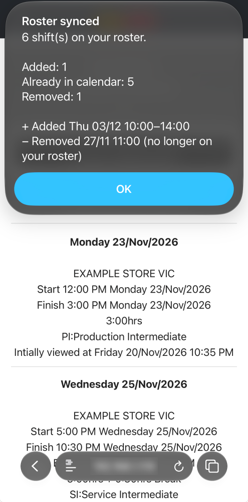
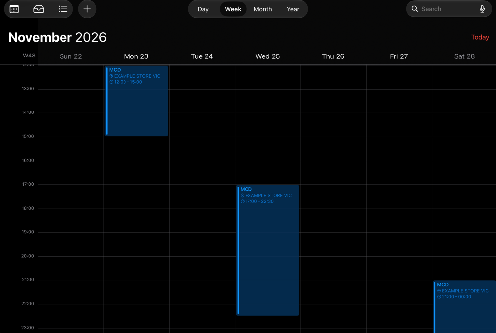
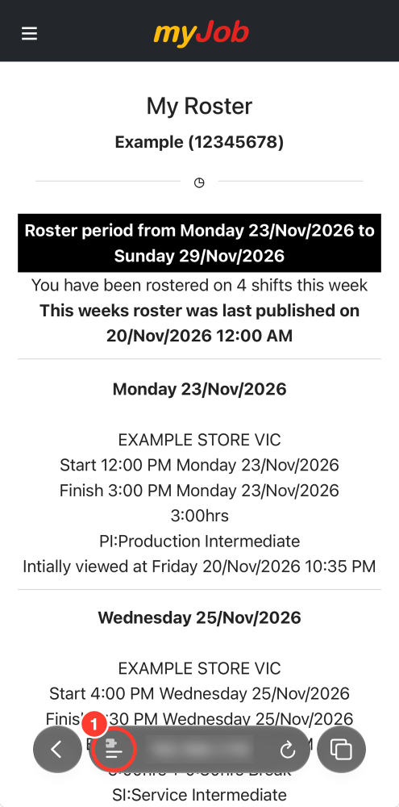
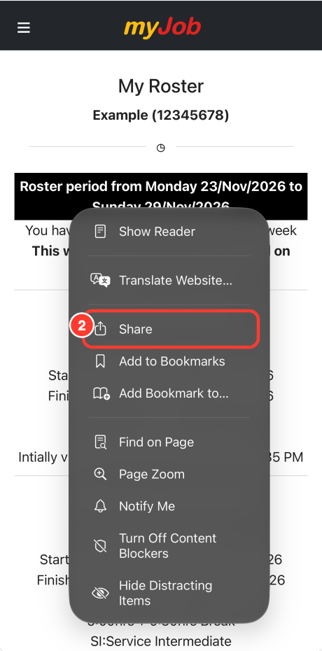
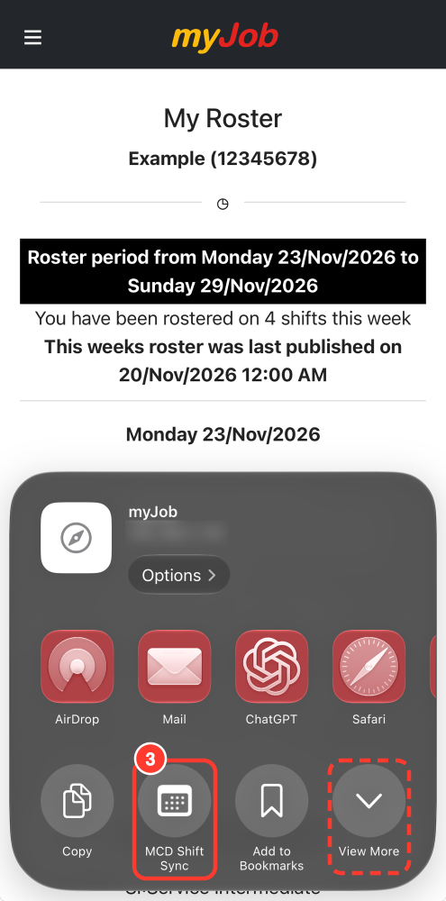
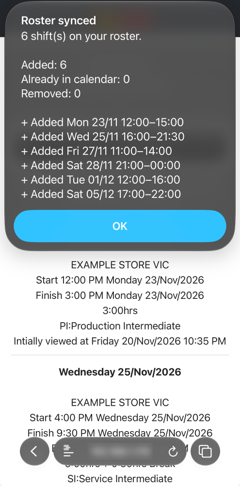
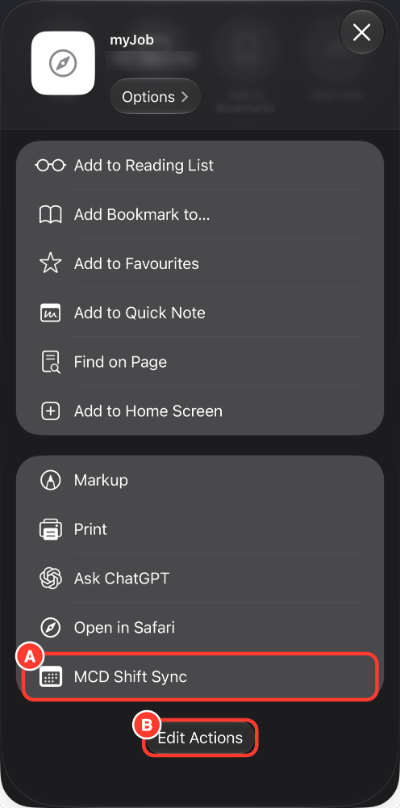
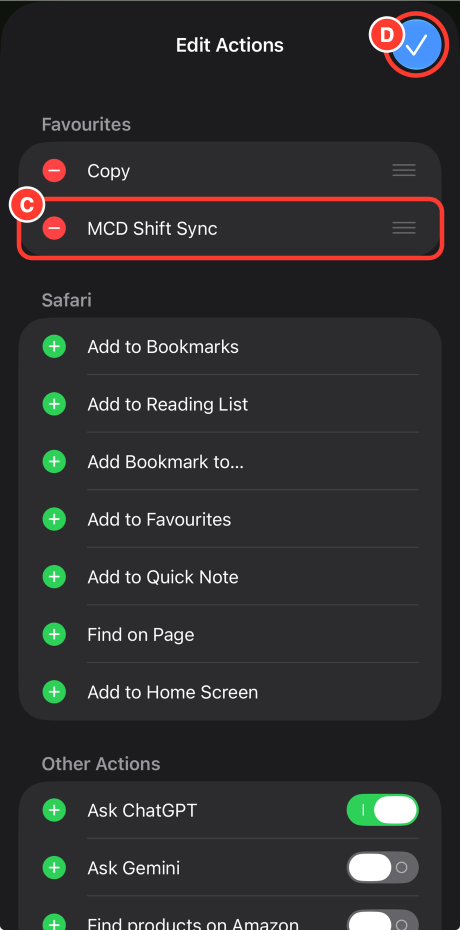

# McDonald's AU Shift Sync

> [!IMPORTANT]
> **The Chrome extension in this repository is no longer maintained.**
> Use the **MCD Shift Sync** iPhone shortcut instead. It puts your myJob shifts straight into your calendar and keeps them up to date. No downloading or importing `.ics` files.

## MCD Shift Sync (iPhone shortcut)

### [➜ Get MCD Shift Sync](https://www.icloud.com/shortcuts/84e456e3c7de4fee96a429ead6b50311)

Or visit **[shifts.skywingjam.com](https://shifts.skywingjam.com)** for a quick guide. On a computer, it has a QR code you can scan with your iPhone.

Every time you run it, it:

- **adds** new shifts from your roster to your calendar,
- **updates** shifts that changed (time, store, role, meal break) and removes any extra copies,
- **removes** shifts that are no longer on your roster, only for the weeks shown on the page. Your iPhone asks you before anything is deleted,
- then shows a short summary of what changed.

For example, after the roster changed (Wed moved later, Fri cancelled, a new Thu shift added), one run updated the calendar to match:

  
  

To protect privacy, all screenshots use a mock roster page with made-up data.

### Install

1. Open the link above on your iPhone and tap **Add Shortcut**.
2. Choose the calendar you want your shifts in.

### Use

1. Open myJob in **Safari**, log in and go to **My Roster**. Tap the page menu button **(1)**, then **Share (2)**.
   On some iPhones the Share button is right on the toolbar instead.
2. Tap **MCD Shift Sync (3)**. Can't see it? Tap **View More**. It's near the bottom, and you can [pin it](#pin-it-to-the-share-sheet) so it's always there.
3. The first time, tap **Always Allow** on the pop-ups.
4. A summary shows what was added, updated and removed. Run it again whenever your roster changes.

  
  
  
  

If it says it can't run scripts: **Settings → Apps → Shortcuts → Advanced → Allow Running Scripts**.

### Pin it to the share sheet

New shortcuts end up at the bottom of the **View More** list. Pin it once to put it in the first row:

- **(A)** In the share sheet, tap **View More** and scroll down. MCD Shift Sync is near the bottom.
- **(B)** Tap **Edit Actions**.
- **(C)** Tap the green **＋** next to MCD Shift Sync so it moves up to **Favourites**.
- **(D)** Tap **✓** to save.

  
  

### Good to know

- **iPhone + Safari only.** Chrome and other browsers on iPhone can't pass the page to a shortcut.
- **It only touches its own events**: events titled `MCD` with a `UID:` line in the notes, within the roster weeks shown. Your other events are left alone.
- **Works with events from the old extension.** Shifts imported from its `.ics` files use the same format, so they're updated instead of duplicated.
- **Safe when something looks wrong.** If the page hasn't fully loaded, or the number of shifts doesn't match what the roster says, it stops and your calendar isn't changed.
- **One shift per day**, as myJob shows it.
- **Website changes** may break it. You'll see "Couldn't sync your roster" and your calendar stays as it was.

### Privacy

Everything happens on your iPhone. The shortcut reads the roster page you're already looking at and writes to your calendar. Nothing is sent anywhere, and your login details aren't stored.

### Disclaimer

Unofficial and not affiliated with, endorsed by, or connected to McDonald's. Made for McDonald's Australia's myJob site only. Found a problem? Please open an issue.

---

Looking for the old Chrome extension? It's archived in [`archive/chrome-extension`](archive/chrome-extension/) (no longer maintained). The shortcut's source is in [`shortcut/`](shortcut/).
